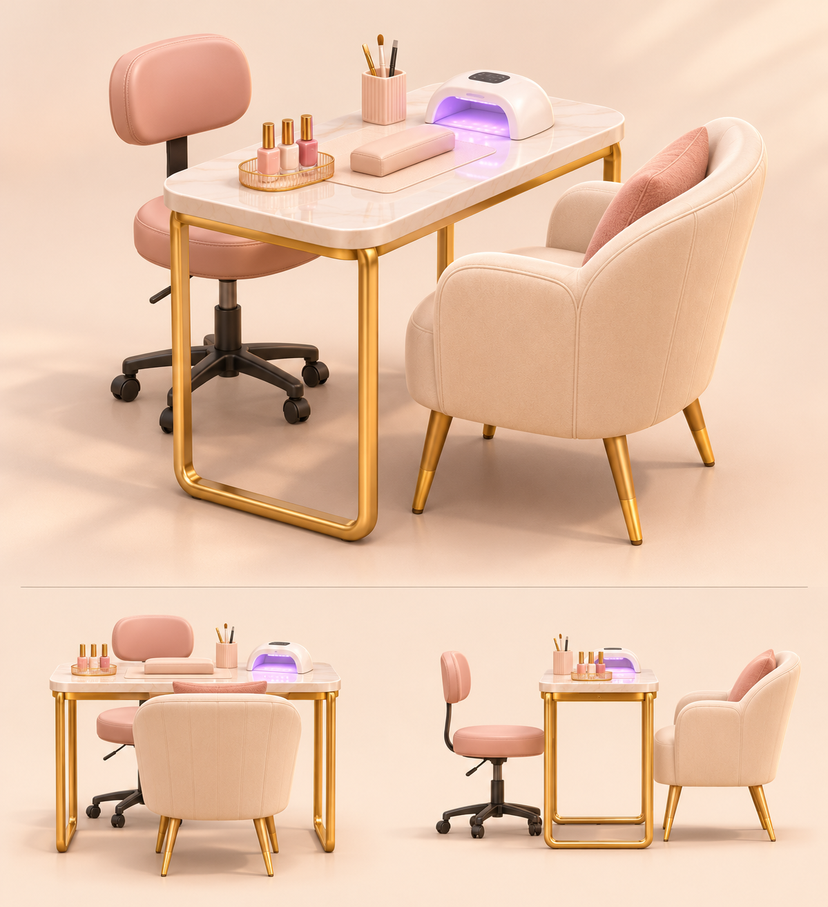
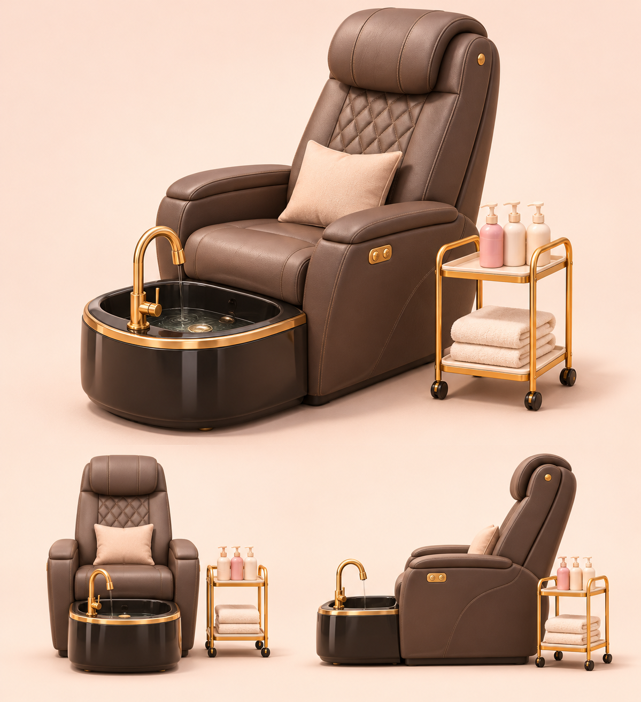

# Phác thảo nội thất V3 — tham chiếu dựng mesh

Hai ảnh dưới đây là **tham chiếu hình dáng** cho mesh Blender V3 đã được áp dụng vào trang xem scene. Cả hai lấy phong cách, màu và vị trí nội thất từ [ảnh tiệm V2](nail-salon-concept-mobile-v2.png). Không có nhân vật. Source có thể chỉnh tại [`nail_furniture_v3.blend`](../packages/assets/source/nail_furniture_v3.blend) hoặc tạo lại bằng [`build_furniture_v3.py`](../tools/blender/build_furniture_v3.py).

## Bàn manicure

Đề xuất: mặt bàn kem vân đá bo tròn; khung ống champagne gold; ghế khách ivory bọc nệm dày với tựa cong, gối blush; ghế thợ thấp màu hồng có chân xoay; máy UV, gối kê tay và khay sơn. Khi dựng geometry, bàn, hai ghế và từng vật dụng sẽ là đối tượng riêng để thay thế/chỉnh sửa.

## Ghế pedicure

Đề xuất: ghế spa taupe nâu đậm với tựa cao, gối đầu, đường may chần, tay vịn và đệm dày; bồn ngâm chân đen bóng có lòng lõm, viền và vòi vàng; xe đẩy nhỏ bên cạnh. Ghế, bồn, vòi và xe đẩy sẽ là các mesh/nhóm độc lập.

Mesh đã được dựng và tích hợp vào cảnh `/?view=salon-v2`. Kích thước hình học vẫn là ước lượng từ hình chiếu của concept, chưa thể xem là số đo chính xác của tiệm hoặc đồ nội thất thật.
