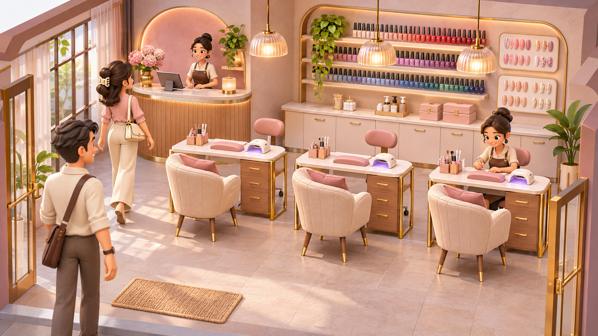

# Phương án hình ảnh tiệm nail 3D — chờ duyệt

Ảnh là bản phác thảo để thống nhất bố cục, chất liệu và phong cách nhân vật. Ảnh không phải mô hình GLB hoặc ảnh chụp từ bản game đang chạy. Chưa thay cảnh 3D hiện tại bằng thiết kế này.

## Kết quả quan sát web tham khảo

- `taixeonline.vercel.app` hiện là trang thông báo chuyển sang [`xeomvn.online`](https://xeomvn.online/). REA quan sát trang cũ trong phiên trình duyệt tạm: `ev_8507bd6683092408b52e9bbcab6cba6e1ed26ed4e6c8ec738ccdf1a2d330e5b3`.
- Ở trang mới, canvas khai báo `data-engine="Babylon.js v7.54.3"`; giao diện tải gói JavaScript `react-*.js`, CSS và một số ảnh WebP. Màn hình đầu là phố Sài Gòn 3D, các tòa nhà dạng khối có màu/vật liệu, đường, cây và chợ Bến Thành. REA quan sát menu và màn hình tạo nhân vật: `ev_6be1e8b0eb1050b1f34ef0ec027b4731edb24344ef4daad5048e789764680ddd`, `ev_f26cd95cb0149641c34780e4319fab660c49a666f2acd52a70dbf6d29de4223a`.
- Trong phạm vi các màn hình đã xem, mạng chưa tải tệp `.glb`, `.gltf` hoặc `.fbx` riêng. Có thể các vật thể được tạo bằng mã hoặc đóng trong gói khác; bằng chứng này **không** xác định cách tác giả dựng từng tòa nhà, xe và người. Mã nguồn gốc là JavaScript hay TypeScript và công cụ dựng mô hình cũng chưa xác minh được. Trang chuyển miền mô tả Vercel và Supabase, nhưng đó là tuyên bố trên trang, không phải kiểm chứng toàn bộ hạ tầng.

## Kiểm kê tài sản nhân vật của chủ tiệm

| Thư mục | Quan sát | Cách dùng đề xuất |
| --- | --- | --- |
| `Cartoon women` | `Character_1.fbx`, `.obj`, `.mtl` và `Texture.rar`. OBJ có khoảng 16 nghìn đỉnh, 15,6 nghìn mặt; MTL tham chiếu hai ảnh texture trong thư mục `Texture`. | Mẫu khách nữ/nhân viên sau khi kiểm tra texture, bộ xương, hướng mặt và tỉ lệ trong Blender. |
| `Cartoon boy` | Có nguồn Blender, FBX, OBJ và GLB. GLB gốc khoảng 94,7 MB, chứa 11 mesh, 21 material, 45 image, 1 skin và 7 animation đều mang tên `faceit_bake_test_action`; chưa thấy clip `walk`, `sit` trong GLB. | Mẫu nam để thử chuyển đổi và tối ưu. Không đưa nguyên GLB 94,7 MB vào web điện thoại. Cần tạo/ghép lại clip đi, đứng, ngồi. |
| `characters cartoon` | 20 tệp JPG minh họa nhân vật nhiều kiểu dáng và tư thế; không có mesh/rig trong thư mục này. | Tham chiếu tỉ lệ và phong cách, không dùng JPG như mô hình 3D. |

Chưa thấy tệp giấy phép trong các ZIP của `Cartoon boy`; cần xác nhận quyền sử dụng và phân phối công khai của từng bộ trước khi đóng gói vào website.

## Quy trình dựng sau khi ảnh được duyệt

1. Chốt sơ đồ và kích thước tiệm thật: vị trí cửa, quầy, ba ghế, lối đi và bảng màu. Giữ các điểm tương tác máy chủ hiện có.
2. Dựng nội thất trong Blender theo cụm: sàn/tường, quầy, một bộ bàn ghế nail nhân bản ba lần, kệ màu, đèn và cây. Dùng mesh bo góc, vật liệu PBR, UV/texture gọn; kiểm tra lối đi và tầm nhìn camera trên điện thoại.
3. Mở các nhân vật có sẵn trong Blender, kiểm tra texture và rig, thống nhất chiều cao. Tạo hoặc retarget clip `idle`, `walk`, `sit`, `stand`, rồi xuất GLB riêng cho nam và nữ.
4. Tối ưu mesh và texture, xuất GLB, kiểm tra trực tiếp bằng [`GLTFLoader` của Three.js](https://threejs.org/docs/pages/GLTFLoader.html). Blender hỗ trợ xuất glTF/GLB cùng vật liệu và hoạt ảnh theo [tài liệu Blender](https://docs.blender.org/manual/en/3.3/addons/import_export/scene_gltf2.html).
5. Thay hình học tạm trong `SalonWorld3D.ts` theo từng cụm, giữ React và Socket.IO cùng quy tắc ghế của máy chủ. Chỉ đổi sang Babylon.js nếu thử nghiệm chứng minh một nhu cầu cụ thể mà Three.js hiện tại không đáp ứng.
6. Kiểm tra trên hai tab và điện thoại: chạm quầy, đi tránh bàn ghế, ghế không bị chiếm trùng, dáng ngồi khớp ghế, FPS và thời gian tải.

## Điều cần duyệt ở ảnh này

Bố cục gồm **quầy bên trái, đúng ba bàn nail, lối đi từ cửa**, chất liệu kem/gỗ/hồng phấn/vàng nhẹ, kệ màu phía sau và nhân vật 3D hoạt hình có tỉ lệ người lớn. Sau khi nhận phản hồi về bố cục và phong cách, mới bắt đầu dựng mô hình và tích hợp asset vào game.
