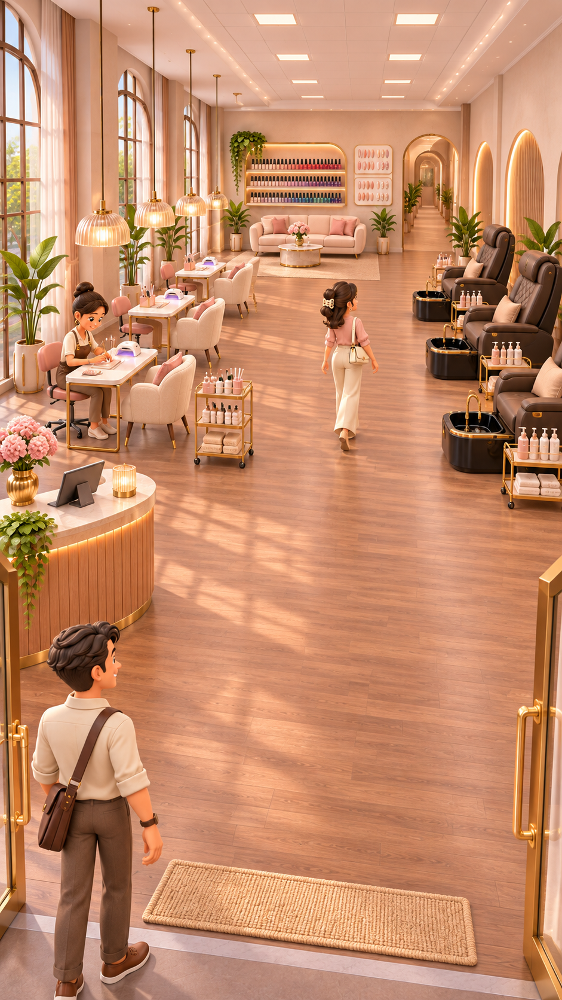

# Phác thảo tiệm nail 3D cho điện thoại — bản 2

Ảnh này mở rộng bản 1 thành một phòng sâu, thoáng, nhìn từ cửa vào theo khung dọc điện thoại. Lối đi giữa nối quầy tiếp tân, ba bàn manicure bên trái, ba ghế pedicure bên phải và khu chờ/kệ màu ở cuối phòng. Đây là ảnh ý tưởng để duyệt, chưa phải ảnh trong game hay bản đo đạc của tiệm.

## Chi tiết lấy từ video

[Reel được cung cấp](https://www.facebook.com/reel/1409612231286451?locale=vi_VN) hiển thị sàn vân gỗ nâu, tường sáng, đèn trần dạng tấm, lối đi dọc, bàn nail với ghế xoay và dãy ghế pedicure tối màu có bồn ngâm chân. REA xem các khung hình công khai sau khi đóng hộp thoại đăng nhập: `ev_b48c4d34abea6e2f847e374a763c39ca29bf0a6f541eee8a80dc0d2356400dff`. Reel hiển thị tên **Q Luxe Nails**. Video không cung cấp kích thước, sơ đồ đầy đủ hoặc vị trí quầy; việc đặt quầy và khu chờ trong ảnh là đề xuất thiết kế.

## Thay đổi so với bản 1

- Tỉ lệ ảnh dọc để thử cảm giác quan sát trên smartphone.
- Phòng dài và rộng hơn, trần cao hơn, khoảng trống giữa các cụm đồ nội thất đủ cho nhân vật di chuyển và gặp nhau.
- Bổ sung dãy pedicure như trong video; giữ ba bàn manicure rõ ràng để nối với luồng chọn dịch vụ hiện có.
- Giữ phong cách nhân vật hoạt hình 3D và chất liệu ấm áp của bản 1; thêm sàn vân gỗ, ghế pedicure tối màu, đèn trần sáng và xe đẩy dụng cụ từ video.

Nếu duyệt bản này, bước dựng cảnh cần ưu tiên camera theo nhân vật trên điện thoại và chia phòng thành các khu tải riêng. Ba ghế manicure hiện có quy tắc chiếm ghế trên máy chủ; ghế pedicure sẽ cần quy tắc dịch vụ/ghế riêng trước khi trở thành vị trí tương tác, để tránh hiển thị ghế có thể ngồi nhưng không dùng được.

## Prompt tạo ảnh

Chế độ: ImageGen tích hợp, chỉnh sửa từ ảnh phác thảo bản 1.

> Edit the provided first nail salon concept into a NEW, substantially more spacious mobile-first version while retaining its beautiful polished stylized-3D adult cartoon character design, warm lighting, and premium manicure detailing. Output a tall portrait 9:16 concept image composed as the in-game camera view on a smartphone, with NO phone bezel and NO UI. Camera stands just inside the entrance and looks diagonally down a broad, unobstructed central walking aisle into a long, airy salon; high ceiling and deeper room, with generous spacing between interaction areas. Use concrete visual cues from the owner's reference video of the salon: warm medium-brown wood-look floorboards, clean light walls and ceiling panel lights, a row of dark charcoal/brown padded pedicure spa thrones with integrated black foot-soak basins along the right, slim manicure tables and rolling technician stools along the left, movable product carts and nail tools. Translate these real features into a refined, beautiful game-ready 3D environment with soft blush, cream and subtle gold accents, clear furniture silhouettes and realistic upholstery. Show exactly three distinct manicure workstations on the left (each with desk, client chair, technician stool), three pedicure spa chairs on the right, a small reception area near the front-left, a waiting sofa and curated nail-color display further back, with open space between them for walking and meeting other avatars. Include only 3 adult stylized cartoon people matching previous concept quality: a female guest walking down the aisle, a male guest near the entrance, a technician at a workstation. Keep the room the hero and the characters smaller in scale so the wider floor plan is obvious. Credible perspective, thoughtful mobile-friendly focal points, warm daylight, elegant cinematic 3D game concept render, physically based materials. Avoid cramped room, avoid furniture blocking the aisle, avoid childlike avatars, avoid extra chairs or people, avoid text/logos/watermarks, avoid any fake UI overlay.
